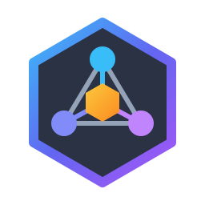

<div align="center">
  
  <h1>Swarm Forge</h1>
  <p><strong>From "60% Vibe Coding" to "95% Production-Ready Delivery": A Heterogeneous Multi-Agent Engineering Methodology Plugin for TypeScript</strong></p>
  <p>
    English · <a href="./README.md">简体中文</a>
  </p>
</div>

---

**Swarm Forge** is an end-to-end engineering methodology plugin built for **Google Antigravity** (and compatible with the `npx skills` ecosystem), tailored for TypeScript full-stack and frontend codebases.

## What Problems Does It Solve?

1. **Stops Reinventing Components**: Enforces a strict **Variant-over-New-Component** rule backed by deterministic TypeScript AST component/variant indexing (`.agents/wiki/_generated/COMPONENT_INDEX.md`).
2. **Cures Cross-Session Amnesia**: Combines a zero-token AST module dependency graph (`MODULE_GRAPH.md` + `graph.json`) with a Karpathy-style compounding semantic wiki (`.agents/wiki/`).
3. **Kills Bloated Technical Plans**: Uses `/grill-me`-style interactive multiple-choice interviews (`grill-spec`, always leading with `(Recommended)`) to lock product & UX boundaries fast—never wasting human time reviewing walls of implementation boilerplate.
4. **Heterogeneous Swarm + Adversarial Review**: Orchestrates **Gemini 3.8 Flash**, **Gemini 4 Hydrogen**, **Gemini 4 Neon**, and **Gemini 4 Carbon** in isolated workspaces with a read-only `strict-review` gate (`>= 90/100` required before delivery).

---

## Installation

### Google Antigravity Plugin (Recommended)

```bash
git clone https://github.com/MICAHFANG/agy-swarm-forge.git
cd agy-swarm-forge
./install.sh          # Copy into ~/.gemini/config/plugins/swarm-forge
# or: ./install.sh --link  (symlink for local plugin development)
```

### Standalone Skills (`npx skills`)

```bash
npx skills add MICAHFANG/agy-swarm-forge
```

---

## Heterogeneous Model Matrix

| Swarm Role | Pinned Model | Responsibility |
| :--- | :--- | :--- |
| **`coordinator`** | Active session model (`Gemini 4 Neon` recommended) | Lightweight orchestration & user communication |
| **`scout` / `wiki`** | `gemini-3.8-flash-medium` | Fast AST graph refresh, component reuse audit & wiki compilation |
| **`author-<slice>`** | `gemini-4-hydrogen-high` | High-velocity component variant expansion, standard slices & unit tests |
| **`author-<core>`** | `gemini-4-neon-high` | Complex cross-module state & architectural changes |
| **`reviewer`** | `gemini-4-neon-high` (default)<br>`gemini-4-carbon-high` (high-risk escalation) | Read-only adversarial review against `.agents/specs/` & reuse gates; escalates to Carbon High for core hubs, concurrency, or auth/billing |

---

## License

[MIT](./LICENSE)
