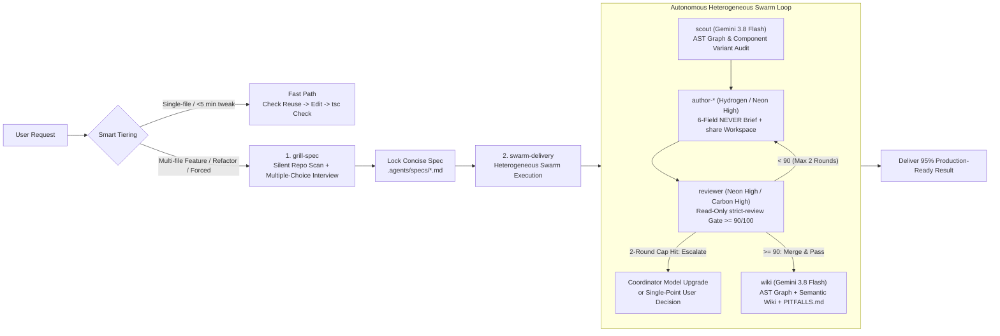

<div align="center">
  
  <h1>agy-swarm-forge</h1>
  <p><strong>From "60% Vibe Coding" to "95% Autonomous Delivery": A Heterogeneous Multi-Agent Engineering Methodology Plugin for Google Antigravity &amp; TypeScript</strong></p>
  <p>
    English · <a href="./README.zh-CN.md">简体中文</a>
  </p>
</div>

---

**`agy-swarm-forge`** is an end-to-end software engineering methodology plugin built for **Google Antigravity** (and compatible with the universal `npx skills` CLI), purpose-built for medium-to-large **TypeScript** full-stack and frontend codebases.

## Why `agy-swarm-forge`?

Modern AI coding agents are capable coders, yet in growing production repositories they routinely stall at **60–70% quality**, leaving developers to babysit the remaining 30%:

1. **Reinventing Components Instead of Extending Variants**: Given a new UI requirement, agents tend to create brand-new components or parallel silos from scratch rather than adding a `variant`, `size`, or `slot` prop to existing primitives.
2. **Cross-Session Amnesia & Missing Blast-Radius Awareness**: Without a structural codebase graph and persistent architecture wiki, agents lose track of shared hubs and accidentally break upstream callers.
3. **500-Line Implementation Plan Fatigue**: Dumping walls of internal technical boilerplate for human approval wastes developer attention while still missing critical UX edge states.
4. **Self-Review Bias & Latency Tradeoffs**: An agent reviewing its own code in the same context window rubber-stamps missing edge cases; conversely, pinning the heaviest frontier reasoning model to the main chat makes everyday interaction sluggish.

---

## Workflow Architecture



---

## What's Inside

| Module | Kind | What It Does |
| :--- | :---: | :--- |
| **`rules/AGENTS.md`** | Always-On Rule | Anti-blackbox 1-line intent broadcasts, zero bloated implementation plans, **Variant-over-New-Component** enforcement, and smart tiering / forced-swarm routing |
| **`ts-repo-wiki`** | Skill + AST Script | Zero external dependencies: leverages the repo's own `node_modules/typescript` compiler AST (with instant regex fallback) to generate `.agents/wiki/_generated/COMPONENT_INDEX.md` (union variants, slots, hooks), `MODULE_GRAPH.md` (Mermaid topology + top fan-in hubs), and `graph.json` (blast-radius lookup), paired with a compounding semantic wiki and `PITFALLS.md` anti-repeat-mistake ledger |
| **`grill-spec`** | Skill | Inspired by `/grill-me`: explores the codebase & wiki silently *before* asking questions, then uses `ask_question` (always leading with a `(Recommended)` option) to resolve product & UX edge states into a concise spec |
| **`swarm-delivery`** | Skill | Orchestrates a heterogeneous multi-model Swarm using standardized **6-field briefs (`JOB / INPUT / REUSE & NEVER / DONE WELL / HANDOFF / ESCALATE`)** across isolated `share` workspaces, protected by a **Max 2-Round Review Circuit Breaker** |
| **`strict-review`** | Skill | Read-only adversarial review rubric scoring 5 hard gates: **Reuse & Variant Design (30%)**, **UX 4-State Completeness (25%)**, **Architectural Cohesion (20%)**, **Strict TypeScript Zero-`any` Safety (15%)**, and **Execution Proof (10%)**, with 2-round stall protection |
| **`hooks.json`** | `SessionStart` Hook | Sub-10ms startup check that detects `.agents/wiki/` in the active workspace and injects instant context awareness on turn 1 |

---

## Heterogeneous Gemini 4 & 3.8 Model Matrix

Keep your primary chat session responsive on **`Gemini 4 Neon`** while `swarm-delivery` pins specialized models to each background worker:

| Swarm Role | Pinned Model | Rationale |
| :--- | :--- | :--- |
| **`coordinator`** | Active session model (`Gemini 4 Neon` recommended) | Responsive human-facing orchestration; never blocks the chat writing heavy implementation code |
| **`scout` / `wiki`** | `gemini-3.8-flash-medium` | Ultra-low-latency AST graph scanning, component reuse auditing, and post-merge wiki compilation |
| **`author-<slice>`** | `gemini-4-hydrogen-high` | 165+ tok/s high-velocity execution for component variant extensions, standard slices, and unit tests |
| **`author-<core>`** | `gemini-4-neon-high` | High-capability workhorse for complex cross-module state flows and core abstractions |
| **`reviewer`** | **`gemini-4-neon-high`** (default)<br>**`gemini-4-carbon-high`** (high-risk escalation) | `Neon High` catches reuse violations and missing UX states at 2x speed for fast rework loops; automatically escalates to `Carbon High` for high-fan-in core hubs, concurrency/race conditions, or auth/billing logic |

---

## Quick Start

### Option 1: Install as a Google Antigravity Global Plugin (Recommended)

```bash
git clone https://github.com/MICAHFANG/agy-swarm-forge.git
cd agy-swarm-forge

# Copy into ~/.gemini/config/plugins/swarm-forge
./install.sh

# Or symlink for live local customization & development:
./install.sh --link
```

Takes effect automatically on your next conversation turn—no restart required. You can toggle or inspect the plugin anytime under **Skills & Customizations** in Antigravity.

### Option 2: Install Standalone Skills (`npx skills`)

```bash
npx skills add MICAHFANG/agy-swarm-forge
```

---

## Everyday Workflow

1. **Bootstrap Existing TypeScript Repos**: Open any TS project and ask:
   > *"Scan this repo and initialize the `.agents/wiki` component variant index and module dependency graph."*
2. **Build Features End-to-End**: Describe what you want to build. The agent checks existing component variants first, interviews you on genuine UX branches with `(Recommended)` defaults, and spins up the heterogeneous Swarm automatically.
3. **Force Swarm Mode Anytime**: Say *"run this with swarm"* or invoke `/swarm-delivery` to force full multi-agent execution and independent adversarial review regardless of task size.

---

## License

[MIT](./LICENSE)
