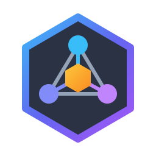
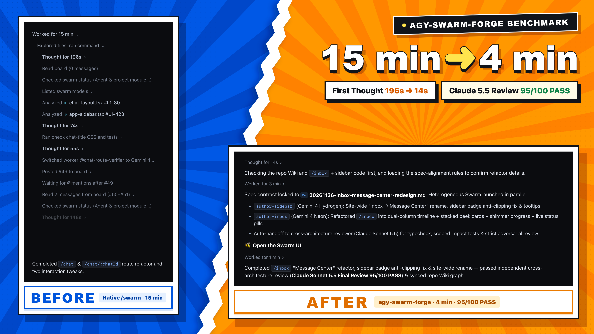
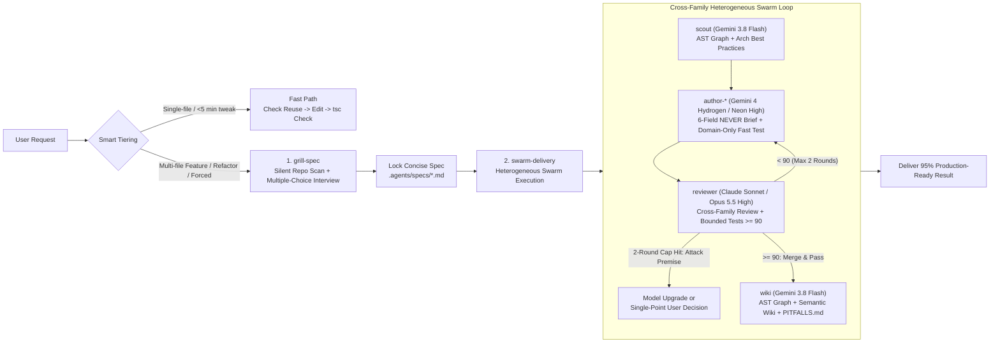

<div align="center">
  
  <h1>agy-swarm-forge</h1>
  <p><strong>From "60% Vibe Coding" to "95% Autonomous Delivery": A Heterogeneous Multi-Agent Engineering Methodology Plugin for Google Antigravity &amp; TypeScript</strong></p>
  <p>
    English · <a href="./README.zh-CN.md">简体中文</a>
  </p>
</div>

---

**`agy-swarm-forge`** is an end-to-end software engineering methodology plugin built for **Google Antigravity** (and compatible with the universal `npx skills` CLI), purpose-built for medium-to-large **TypeScript** full-stack and frontend codebases.

## Real-World Before / After

<p align="center">
  
</p>

- **Before (Bare Native `/swarm` · 15 min)**: Long opaque thinking blocks (`196s` / `74s` / `55s` / `148s`) with zero status broadcasts, repeated board polling (`#49–#51`) and mid-run model switching, and no locked spec contract or independent quality gate.
- **After (`agy-swarm-forge` · 4 min end-to-end)**:
  1. **14s Transparent Alignment**: Reads `.agents/wiki/` first, broadcasts intent in one sentence, and locks a concise spec contract without dumping a 500-line plan.
  2. **3 min Heterogeneous Parallelism**: Dispatches `Gemini 4 Hydrogen` (`author-sidebar`) and `Gemini 4 Neon` (`author-inbox`) concurrently in isolated shared workspaces with zero polling churn.
  3. **1 min Cross-Architecture Review & Wiki Sync**: Automatically hands off to **Claude Sonnet 5.5** for read-only adversarial review + bounded impact tests (**95/100 PASS**), then refreshes the repo AST graph & Wiki.

---

## Why `agy-swarm-forge`?

Modern AI coding agents are capable coders, yet in growing production repositories they routinely stall at **60–70% quality**, leaving developers to babysit the remaining 30%:

1. **Reinventing Components Instead of Extending Variants**: Given a new UI requirement, agents tend to create brand-new components or parallel silos from scratch rather than adding a `variant`, `size`, or `slot` prop to existing primitives.
2. **Cross-Session Amnesia & Missing Blast-Radius Awareness**: Without a structural codebase graph and persistent architecture wiki, agents lose track of shared hubs and accidentally break upstream callers.
3. **500-Line Implementation Plan Fatigue**: Dumping walls of internal technical boilerplate for human approval wastes developer attention while still missing critical UX edge states.
4. **Self-Review Bias & Latency Tradeoffs**: An agent reviewing its own code in the same context window rubber-stamps missing edge cases; conversely, pinning the heaviest frontier reasoning model to the main chat makes everyday interaction sluggish.

---

## Workflow Architecture



---

## What's Inside

| Module | Kind | What It Does |
| :--- | :---: | :--- |
| **`rules/AGENTS.md`** | Always-On Rule | Anti-blackbox 1-line intent broadcasts, zero bloated implementation plans, **Variant-over-New-Component** enforcement, and smart tiering / forced-swarm routing |
| **`ts-repo-wiki`** | Skill + AST Script + Interactive Viewer | Zero external dependencies: uses local `typescript` AST to generate `COMPONENT_INDEX.md`, `MODULE_GRAPH.md`, `graph.json`, and an **offline interactive `graph-viewer.html`** (L1 Module Topology + Circular-Dep Alerts, L2 Blast-Radius Focus, L3 Component Variant Gallery, plus in-chat `generative_ui` support) paired with `PITFALLS.md` |
| **`arch-best-practices`** | Skill + References + Script | Progressive-disclosure software engineering & stack playbooks (**Software Architecture**, **PostgreSQL + Drizzle**, **Hono + Redis**, **Next.js + Strict TS**) plus `find_gold_repos.mjs` to mine battle-tested production OSS repos instead of tutorial slop |
| **`grill-spec`** | Skill | Explores codebase & empirical facts *before* asking questions (never asks what code or a quick probe can settle), then uses `ask_question` with `(Recommended)` defaults to lock a concise spec |
| **`swarm-delivery`** | Skill | Orchestrates heterogeneous Swarms using **6-field `NEVER` briefs**, **Two-Tier Bounded Verification** (authors run domain-local fast tests only; reviewer runs unified affected-scope `tsc` + tests once with hard timeouts), and a **Max 2-Round `Attack-the-Premise` Circuit Breaker** |
| **`strict-review`** | Skill | Evidence-backed adversarial review rubric scoring **Reuse & Variant Design (25%)**, **Architecture & PGSQL/Redis/Hono Red Lines (25%)**, **UX 4-State Completeness (20%)**, **Type System Discipline (15%)**, and **Bounded Affected Verification (15%)** |
| **`hooks.json`** | `SessionStart` Hook | Sub-10ms startup check that detects `.agents/wiki/` in the active workspace and injects instant context awareness on turn 1 |

---

## Cross-Family Model Matrix (Gemini 4 Builders + Claude 5.5 Reviewers)

Same-family self-review suffers from correlated blind spots: a Gemini model reviewing Gemini-authored code tends to forgive the exact shortcuts it would have taken itself. **`agy-swarm-forge` pairs high-velocity Gemini 4/3.8 builders with orthogonal Claude 5.5 adversarial reviewers** (while also load-balancing across separate quota pools):

| Swarm Role | Pinned Model | Rationale |
| :--- | :--- | :--- |
| **`coordinator`** | Active session model (`Gemini 4 Neon` recommended) | Responsive human-facing orchestration; never blocks the chat writing heavy implementation code |
| **`scout` / `wiki`** | `gemini-3.8-flash-medium` | Ultra-low-latency AST graph scanning, component reuse auditing, and post-merge wiki compilation |
| **`author-<slice>`** | `gemini-4-hydrogen-high` | 165+ tok/s high-velocity execution for component variant extensions, standard slices, and domain unit tests |
| **`author-<core>`** | `gemini-4-neon-high` | High-capability workhorse for complex cross-module state flows, PGSQL/Redis concurrency, and core abstractions |
| **`reviewer`** | **Configurable at init (3 modes)**:<br>1. **`claude-sonnet-5-5-high` / `opus-5-5-high`** (default)<br>2. **`gemini-4-carbon-high`** (zero Claude quota)<br>3. **Local External CLI** (`codex` w/ Astra/Sol, `claude` CLI, `opencode`) | During initialization, `detect_env.mjs` scans installed local Coding CLIs and prompts you via `ask_question` to pick your exact per-stage models (saved to `.agents/swarm-forge.json`), so every subscription tier gets true cross-model review without burning scarce Claude quota |

---

## Quick Start

### Option 1: Install as a Google Antigravity Global Plugin (Recommended)

```bash
git clone https://github.com/MICAHFANG/agy-swarm-forge.git
cd agy-swarm-forge

# Copy into ~/.gemini/config/plugins/swarm-forge
./install.sh

# Or symlink for live local customization & development:
./install.sh --link
```

Takes effect automatically on your next conversation turn—no restart required. You can toggle or inspect the plugin anytime under **Skills & Customizations** in Antigravity.

### Option 2: Install Standalone Skills (`npx skills`)

```bash
npx skills add MICAHFANG/agy-swarm-forge
```

---

## Everyday Workflow

1. **Bootstrap Existing TypeScript Repos**: Open any TS project and ask:
   > *"Scan this repo and initialize the `.agents/wiki` component variant index and module dependency graph."*
2. **Build Features End-to-End**: Describe what you want to build. The agent checks existing component variants first, interviews you on genuine UX branches with `(Recommended)` defaults, and spins up the heterogeneous Swarm automatically.
3. **Force Swarm Mode Anytime**: Say *"run this with swarm"* or invoke `/swarm-delivery` to force full multi-agent execution and independent adversarial review regardless of task size.

---

## License

[MIT](./LICENSE)
