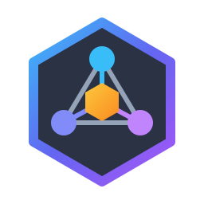
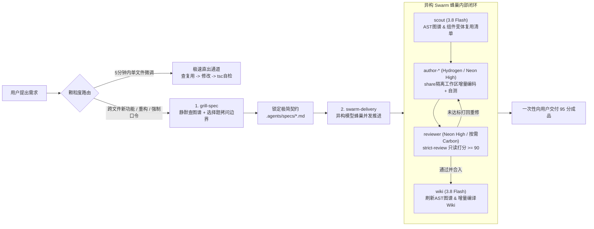

<div align="center">
  
  <h1>agy-swarm-forge</h1>
  <p><strong>从 60 分“能跑就行”到 95 分“免督促一次交付”的 TypeScript 异构多代理工程方法论插件</strong></p>
  <p>
    <a href="./README.md">English</a> · 简体中文
  </p>
</div>

---

**`agy-swarm-forge`** 是一套专为 **Google Antigravity**（同时兼容 `npx skills` 生态）打造的端到端研发方法论插件，面向 TypeScript 全栈与前端工程团队。

## 为什么做这个项目？

AI 编程代理单点编码能力已经很强，但在真实中大型项目里往往卡在 **60~70 分**，剩下 30 分需要开发者反复催促返工：

1. **爱重复造轮子**：新需求一来直接新建组件/新模块，而不是在既有组件上扩展 `variant / size / slot` Props 或顺着既有链路增量演进；
2. **跨会话失忆 & 缺少全局视野**：项目变大后不知道已有能力在哪、改一个底层文件会影响哪些调用方；
3. **冗长技术计划浪费人类注意力**：动辄输出几百行内部技术细节求审批，而真正重要的交互边界与异常四态却没对齐；
4. **自己写自己审必然放水**：缺乏独立只读视角的对抗式 Code Review；单挂重推理模型又会导致日常对话卡顿不跟手。

---

## 核心工作流架构



---

## 四大核心模块（Skills + Rules + AST Graph）

| 组件 | 类型 | 作用说明 |
| :--- | :---: | :--- |
| **`rules/AGENTS.md`** | 常驻微规则 | 反黑盒一句话意图播报、禁止倾倒冗长技术计划、**组件变体优先（Variant over New Component）**、智能分级与强制口令路由 |
| **`ts-repo-wiki`** | Skill + Node 脚本 | 零外部依赖安装：自动调用项目本地 `typescript` 编译器 AST（无依赖时自动降级）秒级生成 `.agents/wiki/_generated/` 组件变体枚举表、Mermaid 模块拓扑图与反向依赖索引，配合 Karpathy `llm-wiki` 风格原位更新业务语义词条 |
| **`grill-spec`** | Skill | 吸收 `/grill-me` 精髓：先静默查代码过滤废话问题，再用 `ask_question`（首选项固定带 `(Recommended)`）逐层敲定交互与 UI 四态，生成极简验收契约 |
| **`swarm-delivery`** | Skill | 免审冗长技术计划，按异构模型矩阵拉起多代理并发编码、验证、互审与 Wiki 回写 |
| **`strict-review`** | Skill | 独立只读终审评分卡：严卡**重复造轮子（30分）、UI四态完整度（25分）、架构同构（20分）、零 `any` 类型严密性（15分）、真实验证证据（10分）**，低于 90 分内部打回重修 |
| **`hooks.json`** | `SessionStart` Hook | 新会话启动时毫秒级检测工作区 `.agents/wiki/` 状态并自动注入上下文提示，消除跨会话失忆 |

---

## Gemini 4 & 3.8 异构模型分工矩阵

日常建议将主聊天窗口模型设为均衡跟手的 **`Gemini 4 Neon`**，后台蜂巢会自动按职责异构挂载：

| 蜂巢角色 | 模型配置 | 设计原因 |
| :--- | :--- | :--- |
| **`coordinator`（主控）** | 当前会话模型（推荐 `Gemini 4 Neon`） | 保持主界面秒回跟手，只做调度仲裁，不下场写重代码 |
| **`scout` / `wiki`** | `gemini-3.8-flash-medium` | 极低延迟完成图谱扫描、复用审计与收尾文档同步 |
| **`author-<slice>`（常规工兵）** | `gemini-4-hydrogen-high` | 165+ tok/s 高速完成组件变体扩展、常规业务切片与单测补全 |
| **`author-<core>`（核心攻坚）** | `gemini-4-neon-high` | 处理复杂跨模块状态流转与高难度抽象改造 |
| **`reviewer`（独立终审官）** | 默认 **`gemini-4-neon-high`**<br>高危按需升级 **`gemini-4-carbon-high`** | 日常 90% 场景用 `Neon High` 兼顾严苛清单审查与双倍返修速度；涉及高 Fan-In 核心底座、复杂并发竞态或鉴权计费时自动升级 `Carbon High` 深度推演 |

---

## 快速安装

### 方式一：安装为 Google Antigravity 全局插件（推荐）

```bash
git clone https://github.com/MICAHFANG/agy-swarm-forge.git
cd agy-swarm-forge

# 拷贝安装到 ~/.gemini/config/plugins/swarm-forge
./install.sh

# 如果你正在本地修改调试本仓库，可使用软链接模式保持实时同步：
./install.sh --link
```

安装后无需重启 Antigravity，下一轮对话起自动生效，也可在左侧 **Skills & Customizations** 面板中随时一键开关。

### 方式二：仅安装 Skills（兼容 `skills` CLI 的其他 Agent 工具）

```bash
npx skills add MICAHFANG/agy-swarm-forge
```

---

## 日常使用姿势

1. **老项目首次建图谱**：打开任意 TypeScript 仓库，输入：
   > “扫描当前仓库，初始化 `.agents/wiki` 组件变体与模块依赖图谱”
2. **开发新功能（全自动分级）**：直接描述你的业务诉求，Agent 会先查现有组件并抛出带 `(Recommended)` 的关键选择题与你对齐边界，敲定后自动拉起 Swarm 交付。
3. **强制拉起异构蜂巢**：任何时候想跳过单代理直出、强制走多代理并发与独立终审，只需说一句 **“用 swarm 推进” / “起蜂巢”** 或输入斜杠命令 **`/swarm-delivery`**。

---

## License

[MIT](./LICENSE)
