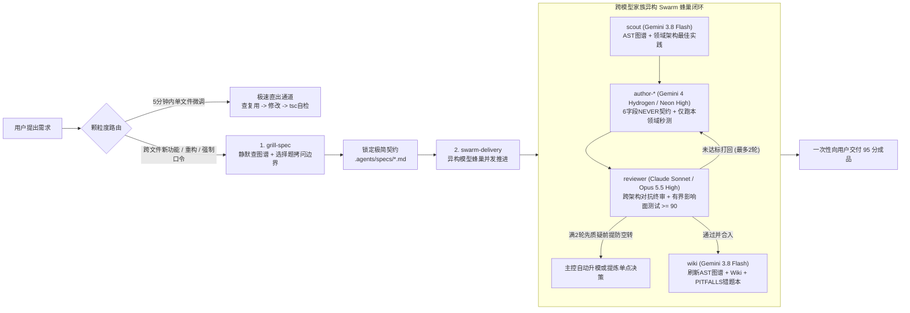

<div align="center">
  
  <h1>agy-swarm-forge</h1>
  <p><strong>从 60 分“能跑就行”到 95 分“免督促一次交付”的 TypeScript 异构多代理工程方法论插件</strong></p>
  <p>
    <a href="./README.md">English</a> · 简体中文
  </p>
</div>

---

**`agy-swarm-forge`** 是一套专为 **Google Antigravity**（同时兼容 `npx skills` 生态）打造的端到端研发方法论插件，面向 TypeScript 全栈与前端工程团队。

## 为什么做这个项目？

AI 编程代理单点编码能力已经很强，但在真实中大型项目里往往卡在 **60~70 分**，剩下 30 分需要开发者反复催促返工：

1. **爱重复造轮子**：新需求一来直接新建组件/新模块，而不是在既有组件上扩展 `variant / size / slot` Props 或顺着既有链路增量演进；
2. **跨会话失忆 & 缺少全局视野**：项目变大后不知道已有能力在哪、改一个底层文件会影响哪些调用方；
3. **冗长技术计划浪费人类注意力**：动辄输出几百行内部技术细节求审批，而真正重要的交互边界与异常四态却没对齐；
4. **自己写自己审必然放水**：缺乏独立只读视角的对抗式 Code Review；单挂重推理模型又会导致日常对话卡顿不跟手。

---

## 核心工作流架构



---

## 五大核心模块（Skills + Rules + AST Graph）

| 组件 | 类型 | 作用说明 |
| :--- | :---: | :--- |
| **`rules/AGENTS.md`** | 常驻微规则 | 反黑盒一句话意图播报、禁止倾倒冗长技术计划、**组件变体优先（Variant over New Component）**、智能分级与强制口令路由 |
| **`ts-repo-wiki`** | Skill + AST 脚本 + 可视化看板 | 零外部依赖：调用本地 `typescript` AST 秒级生成 `COMPONENT_INDEX.md`、`MODULE_GRAPH.md`、`graph.json` 及**面向人类的离线交互式看板 `graph-viewer.html`**（L1 模块拓扑与循环依赖标红 / L2 单文件爆炸半径 / L3 组件变体库，同时支持对话内 `generative_ui` 即时渲染）与 `PITFALLS.md` 错题本 |
| **`arch-best-practices`** | Skill + References + 脚本 | 按需懒加载软件工程与技术栈硬核范式库（**经典分层与设计模式、PostgreSQL + Drizzle 调优、Hono + Redis 高并发、Next.js + 严格 TS**），附带 `find_gold_repos.mjs` 自动过滤低质 Demo 定位顶级生产开源标杆 |
| **`grill-spec`** | Skill | 吸收 `/grill-me` 与 `pstack` 精髓：代码可查事实与实验可证事实绝不问人，只用带 `(Recommended)` 的选择题敲定产品与交互边界 |
| **`swarm-delivery`** | Skill | 采用**含 `NEVER` 禁区的 6 字段契约**与**两级有界验证**（Author 禁跑全仓测试，仅跑本领域 `<=30s` 局部单测；Reviewer 统一执行唯一一次带 `60~90s` 硬超时的影响面收敛测试）+ **2 轮质疑前提熔断** |
| **`strict-review`** | Skill | 实证制只读终审评分卡：严卡**复用与零双轨腐化（25分）、软件架构与 PGSQL/Redis/Hono 红线（25分）、UI四态完整度（20分）、TS类型系统纪律（15分）、有界影响面集成测试（15分）** |
| **`hooks.json`** | `SessionStart` Hook | 新会话启动时毫秒级检测工作区 `.agents/wiki/` 状态并自动注入上下文提示，消除跨会话失忆 |

---

## 跨家族异构模型分工矩阵（Gemini 4 编码 + Claude 5.5 审查）

同一模型家族既写代码又做审查，容易出现“同源盲区（自己觉得顺眼的漏洞审不出来）”。日常建议主聊天窗口挂均衡跟手的 **`Gemini 4 Neon`**，后台蜂巢自动按**跨家族正交互补 + 双配额池分流**挂载：

| 蜂巢角色 | 模型配置 | 设计原因 |
| :--- | :--- | :--- |
| **`coordinator`（主控）** | 当前会话模型（推荐 `Gemini 4 Neon`） | 保持主界面秒回跟手，只做调度仲裁，不下场写重代码 |
| **`scout` / `wiki`** | `gemini-3.8-flash-medium` | 极低延迟完成图谱扫描、复用审计与收尾文档同步 |
| **`author-<slice>`（常规工兵）** | `gemini-4-hydrogen-high` | 165+ tok/s 高速完成组件变体扩展、常规业务切片与本领域局部单测 |
| **`author-<core>`（核心攻坚）** | `gemini-4-neon-high` | 处理复杂跨模块数据建模、PGSQL/Redis 并发链路与底层抽象 |
| **`reviewer`（跨架构终审官）** | 默认 **`claude-sonnet-5-5-high`**<br>高危升级 **`claude-opus-5-5-high`**<br>*(配额兜底：`gemini-4-neon/carbon-high`)* | 用不同架构的 Claude 5.5 交叉挑刺 Gemini 4 的代码产出，打破同源放水盲区并分流独立配额池；涉及高 Fan-In 核心底座、复杂并发锁或鉴权计费时升级 `Claude Opus 5.5 High` |

---

## 快速安装

### 方式一：安装为 Google Antigravity 全局插件（推荐）

```bash
git clone https://github.com/MICAHFANG/agy-swarm-forge.git
cd agy-swarm-forge

# 拷贝安装到 ~/.gemini/config/plugins/swarm-forge
./install.sh

# 如果你正在本地修改调试本仓库，可使用软链接模式保持实时同步：
./install.sh --link
```

安装后无需重启 Antigravity，下一轮对话起自动生效，也可在左侧 **Skills & Customizations** 面板中随时一键开关。

### 方式二：仅安装 Skills（兼容 `skills` CLI 的其他 Agent 工具）

```bash
npx skills add MICAHFANG/agy-swarm-forge
```

---

## 日常使用姿势

1. **老项目首次建图谱**：打开任意 TypeScript 仓库，输入：
   > “扫描当前仓库，初始化 `.agents/wiki` 组件变体与模块依赖图谱”
2. **开发新功能（全自动分级）**：直接描述你的业务诉求，Agent 会先查现有组件并抛出带 `(Recommended)` 的关键选择题与你对齐边界，敲定后自动拉起 Swarm 交付。
3. **强制拉起异构蜂巢**：任何时候想跳过单代理直出、强制走多代理并发与独立终审，只需说一句 **“用 swarm 推进” / “起蜂巢”** 或输入斜杠命令 **`/swarm-delivery`**。

---

## License

[MIT](./LICENSE)
